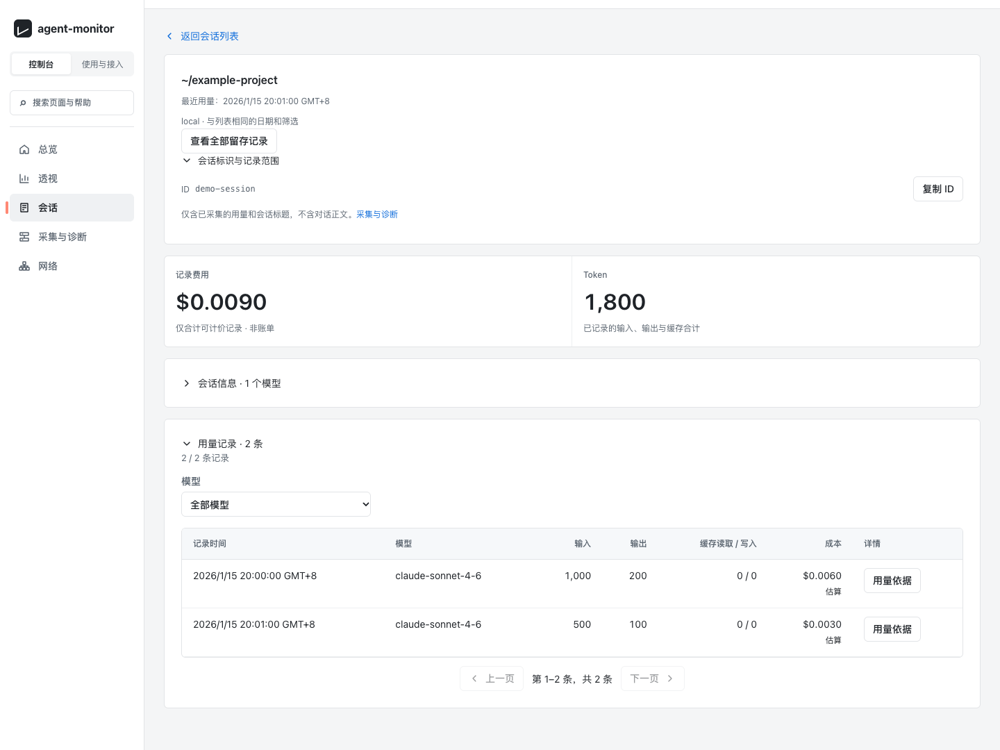
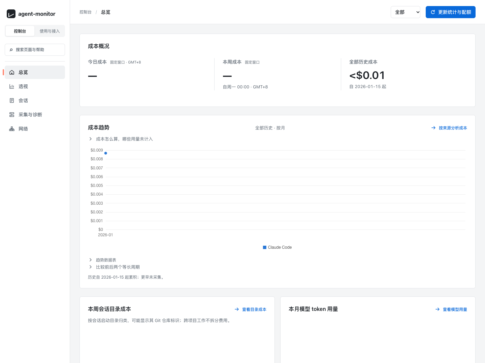

# agent-monitor

[](https://github.com/lindong28/agent-monitor/actions/workflows/ci.yml)

面向个人的 **Claude Code 与 Codex 用量**命令行工具和 Web 仪表盘。你可以查看已记录的 token 用量与估算费用、查找会话、对比账号额度记录，以及排查采集或网络故障。仪表盘目前使用中文界面。

agent-monitor 读取本地 agent 日志，也可以通过 SSH 汇总你明确配置的机器快照。它不转发模型请求，也不依赖其他项目的服务或配置。

它帮助你回答：**这些 token 用在了哪个项目或会话上？保留的记录能说明多少费用？** 从**总览**进入**会话**，再查看某个会话的**用量记录**。费用根据记录中的用量估算，并非服务商账单；额度是带时间戳的观测结果，不能保证请求一定成功。

**请在自己的电脑或可信网络中运行。** 仪表盘没有客户端鉴权。下面的快速上手命令绑定到 `127.0.0.1`；直接运行 `./agent-monitor start` 则默认监听所有网络接口。不要将它直接暴露到公网。若想先体验而不访问自己的账号，请使用[内置示例](#try-the-included-sample-without-your-accounts)。

下面的虚构示例展示了一个会话的 1,800 个 token 如何分布在两条用量记录中：



<details>
<summary>查看示例的费用总览</summary>



</details>

<a id="release-status"></a>

## 发布状态

公开源码位于 [lindong28/agent-monitor](https://github.com/lindong28/agent-monitor)。开发和受支持的部署入口使用 `main`；[发布版本](https://github.com/lindong28/agent-monitor/releases)标明经过测试的源码快照及其验证范围。项目自有代码采用 MIT 许可证，纳入的第三方源码保留各自的许可证。详见 [LICENSE](LICENSE)、[第三方声明](THIRD-PARTY-NOTICES.md)和[贡献指南](CONTRIBUTING.md)。基于早期私有历史的安装，更新前必须先按[现有安装迁移指南](docs/public-usage.md#transition-an-existing-installation)处理。

<a id="install-with-your-coding-agent"></a>

## 让编程 agent 帮你安装

将下面的提示词粘贴给你的编程 agent：

```text
请从 https://github.com/lindong28/agent-monitor 克隆一份新的源码并安装 agent-monitor。阅读 README，按项目支持的安装和首次使用说明操作，帮我查看用量汇总，并在仪表盘中打开一个会话。访问我的真实 agent 日志或服务商账号状态前，请先征得我的同意，包括自动额度查询；未获同意时，使用文档中的隔离示例。保留已有配置和数据。完成后说明哪些操作成功、使用的源码版本、如何打开和停止，以及缺少的前置条件或尚未验证的可选功能。
```

克隆之前就可以使用这段提示词。具体操作说明已包含在仓库中，不需要维护者专用的 skills 或账号。

<a id="requirements"></a>

## 环境要求

- Python 3.10 或更新版本，包含 `venv` 和 `pip`；另需 Git、curl 和 `nc`（netcat）。
- x86-64 或 ARM64 平台上的 macOS 或 Linux。macOS 支持可选的 LaunchAgents。Linux 需要 Electron 的共享库和可用的 Chromium 沙箱，详见 [Linux 沙箱配置](docs/public-usage.md#linux-sandbox-setup)。安装器会报告缺少的库。目前的生命周期脚本不支持 Windows。
- 安装时需要联网下载 Python 包、Chart.js、IBM Plex 字体，以及固定版本的 Electron 系统代理运行时。下载内容保存在本源码目录的 `.venv`、`web/vendor` 和 `.runtime` 中。
- 查看真实用量需要你自己的 Claude Code/Codex 日志。服务商 CLI、登录和订阅权限仅在可选的账号或额度操作中需要；连接远程机器时才需要 SSH 和 rsync。

核心日志分析流程无需登录服务商，也无需调用模型。安装器会短暂启动代理辅助进程进行检查；使用 `--no-services` 时，不会安装后台服务或执行公网探测。

<a id="first-installation"></a>

## 首次安装

运行安装器前，先选择**一种**方式：初次体验使用[隔离示例](#try-the-included-sample-without-your-accounts)，日常使用则选择[自己的数据](#use-your-own-data)。两种方式都需要新建 Git 克隆：采集过程会校验已提交的源码身份，而 GitHub 下载的 ZIP/tar 源码包不包含所需的 Git 信息。已有私有版本安装必须先使用[迁移指南](docs/public-usage.md#transition-an-existing-installation)。

即使指定 `--no-services`，安装器也会在所选 HOME 的 `.local/bin` 下创建或更新 `agent-monitor` 和 `ip-check` 链接。普通安装可能替换指向其他源码目录的链接。安装器不会将该目录加入 PATH，因此下文使用 `./agent-monitor`。可以在安装命令前设置 `AGENT_MONITOR_PYTHON=/path/to/python3` 来选择 Python 3.10+；已有的旧版 `.venv` 会保留，需要按[运行时恢复说明](docs/public-usage.md#python-runtime-rebuild)处理。

<a id="try-the-included-sample-without-your-accounts"></a>

### 不访问真实账号，体验内置示例

这份独立的源码目录仅用于虚构数据。它的 HOME 固定放在 Git 忽略的 `.runtime/demo-home` 中，让安装、重启和更新复用同一个不含真实账号的环境。安装和启动都不会使用你日常 HOME 中的 CLI 链接或 agent 数据。

```bash
git clone https://github.com/lindong28/agent-monitor agent-monitor-demo
cd agent-monitor-demo
demo_home="$PWD/.runtime/demo-home"
mkdir -p "$demo_home"
cp -R examples/demo-home/. "$demo_home/"
HOME="$demo_home" CLAUDE_CONFIG_DIR="$demo_home/.claude" CODEX_HOME="$demo_home/.codex" \
  ./install.sh --no-services
```

在这份源码目录中，使用相同环境启动或重启示例：

```bash
demo_home="$PWD/.runtime/demo-home"
HOME="$demo_home" CLAUDE_CONFIG_DIR="$demo_home/.claude" CODEX_HOME="$demo_home/.codex" \
  AGENT_MONITOR_BIND=127.0.0.1 ./agent-monitor start
./agent-monitor status
```

示例包含 2026 年 1 月 15 日同一会话中的两条虚构 Claude 用量记录，共 1,500 个输入 token 和 300 个输出 token。它不含凭据，也不能用于验证实时额度或服务商登录。

打开命令输出的网址，选择**总览 → 全部**，查看包含示例日期在内的历史费用。再选择**会话 → 全部**，打开标为 `~/example-project` 的那一行；列表和会话详情都会显示总计 1,800 个 token。在详情中展开**用量记录**，查看两条记录；展开**会话标识与记录范围**，确认 ID 为 `demo-session`。该 ID 并不是列表中显示的标签。

这个示例用虚构输入运行正常的解析器和仪表盘流程。自动额度刷新仍会执行，但示例没有已登录账号的元数据，因此额度不可用是预期结果。体验示例时，不要点击服务商登录、发送消息或网络诊断。服务端可能尝试刷新公开价格数据，失败时使用内置价格，因此这不是离线模式，但无需发出模型请求。删除这份临时安装前，先运行 `./agent-monitor stop`。重启或更新时保留它的 HOME，并使用上面的同一组示例命令。运行状态属于这份源码目录，仅改变 HOME 不会清除此前采集的数据。不要把示例目录改作真实数据安装；请另外克隆一份。

<a id="use-your-own-data"></a>

### 使用自己的数据

使用真实 HOME 后，monitor 就能读取本地 agent 日志和当前服务商账号状态。打开仪表盘（包括执行 `./agent-monitor open`）可能使用已有登录状态，自动查询当前账号额度。只有在你允许这些读取和查询时，才继续下面的步骤；否则请使用上面的示例。账号登录和发送消息是另外的可选操作。

```bash
git clone https://github.com/lindong28/agent-monitor agent-monitor
cd agent-monitor
./install.sh --no-services
AGENT_MONITOR_BIND=127.0.0.1 ./agent-monitor start
./agent-monitor status
./agent-monitor open
```

打开 `start` 输出的地址，在**总览**中查看已记录的 token 和估算费用。进入**会话**，将日期范围设为**全部**，再选择一个会话查看用量记录。缺少日志时会显示空视图，这不代表历史支出为零。

源码默认监听 `0.0.0.0`，使用 39001 或之后第一个空闲端口；上面的示例仅监听本机回环地址。可以通过 `AGENT_MONITOR_PORT` 指定其他起始端口。请在自己的安装记录中保留自定义 HOME、数据源覆盖设置、监听地址和端口，以便更新时复用。详见[用量与数据](docs/public-usage.md#local-data-and-first-results)。

<a id="configuration-and-updates"></a>

## 配置与更新

新安装默认只有一台本地机器，Hub 模式关闭。若要自定义机器名或 SSH 目标，将 `examples/machines.json` 复制为 **`machines.local.json`**，然后编辑该文件。可选的 Hub 配置同样使用 **`hub.local.json`**。进程启动时，本地配置优先于对应的受版本控制的默认配置。本地配置无效时会明确报错，不会退回另一组机器配置。新增或删除本地配置文件后，请重启。

只有一台机器应设置 `self: true`。开始采集数据后，应保持机器名、SSH 身份和 `retired_names` 稳定。不要用示例覆盖已有配置。安装器会保留本地配置文件、已有 `state`（包括软链接）和持久锁。Git 会忽略本地配置及运行时数据。迁移和多机配置详见[配置与保留数据](docs/public-usage.md#configuration-and-retained-data)。

**停止任何组件之前**，先选择更新方式：[手动更新](docs/public-usage.md#manual-updates)保留示例或真实数据的启动环境；[服务管理下的部署](docs/public-usage.md#services-and-deployment)保留受管进程设置。不要在示例目录中运行普通的真实数据启动命令。重新安装不会迁移机器身份，也不会清除保留的历史数据。

<a id="common-operations-and-services"></a>

## 常用操作与服务

| 任务 | 入口 |
| --- | --- |
| 查看或停止手动启动的仪表盘 | `./agent-monitor status` / `./agent-monitor stop` |
| 查看项目管理的全部组件 | `./agent-monitor service status`（或 `./status.sh`） |
| 启用定时采集或 macOS Hub | [服务配置与组件操作](docs/public-usage.md#services-and-deployment) |
| 汇总已配置的机器 | [多机配置](docs/public-usage.md#optional-multi-machine-collection) |
| 使用可选的账号或浏览器设备操作 | [账号与连接器指南](docs/public-usage.md#optional-quota-and-account-actions) |
| 移除项目管理的服务和 CLI 集成 | `./uninstall.sh`；保留源码、状态和锁。详见[组件归属与实例选择](docs/public-usage.md#services-and-deployment) |

`--no-services` 不改变服务。macOS 的普通安装会管理定时采集和已配置的 Hub，连接器需要主动启用。Linux 提供 CLI 和手动启动的仪表盘。Hub 客户端通常打开中心仪表盘；可以通过[本地实例选择方式](docs/public-usage.md#services-and-deployment)管理可选的本地实例。受管更新可能中断正在执行的操作：应先等账号操作结束，不要重发结果不确定的消息。组件重启、恢复和运行时替换的细节见上述指南。

<a id="what-the-numbers-mean"></a>

## 如何理解这些数字

用量来自保留的本地记录，并非服务商账单。已知费用是可计价记录的费用小计；价格未知或用量不完整不等于零。Codex 分页中继承的用量，以及 Claude 流式输出中的重复记录，会按既有核算规则去重。汇总历史的保留时间可能长于会话明细。额度记录有各自的观测时间；记录中的重置时间已过，不代表新额度已经可用。日期边界按 Asia/Shanghai 时区计算。

<a id="repository-and-documentation"></a>

## 目录与文档

```text
agent-monitor / install.sh / deploy.py   CLI、安装和部署入口
*.py                                    后端模块；按职责分组见下方职责索引
parsers/                                Claude/Codex 日志与账号数据源读取器
web/                                    仪表盘静态页面、JavaScript 和样式
proxy_runtime/                          系统代理解析辅助程序
ip_check/                               网络诊断与归因
examples/                               公开配置示例与虚构样本
scripts/ / tests/                       显式验收、测量与回归测试
docs/                                   使用、架构、运维与核算指南
```

| 阅读目的 | 从这里开始 |
| --- | --- |
| 配置、更新或排障 | [使用与运维](docs/public-usage.md) |
| 查找改动涉及的模块与回归测试 | [职责索引](docs/public-architecture.md#responsibility-map) |
| 搭建开发环境并选择检查项 | [贡献与验证](CONTRIBUTING.md) |
| 理解核算规则与解析器边界 | [核算契约](docs/references/metrics.md) |
| 报告敏感问题 | [安全政策](SECURITY.md) |

`.venv/`、`.runtime/`、`web/vendor/`、`state/` 和 `*.local.json` 属于本地运行时或配置，不纳入源码版本控制。更新时应保留已有状态目录的软链接和身份信息。

<a id="attribution"></a>

## 作者与来源

由 Dong Lin 创建。agent-monitor 延续了从 ai-agent-config 提交 `3d61487d5386dfe9bb6ba7d26807005bbf0bd7f2` 中提取的 `tt-web` 实现。这一来源关系不构成运行时依赖。第三方包保留各自的许可证。
